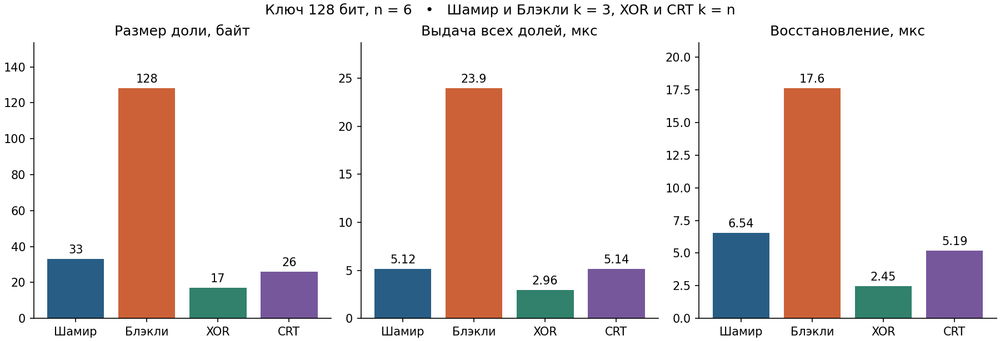
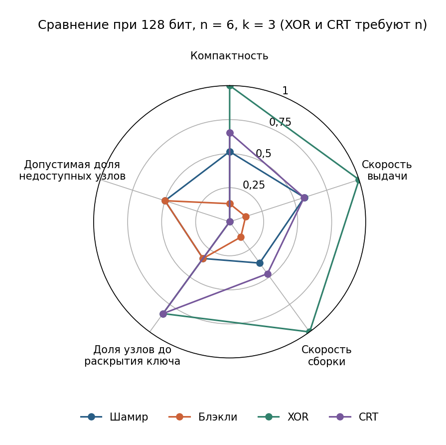
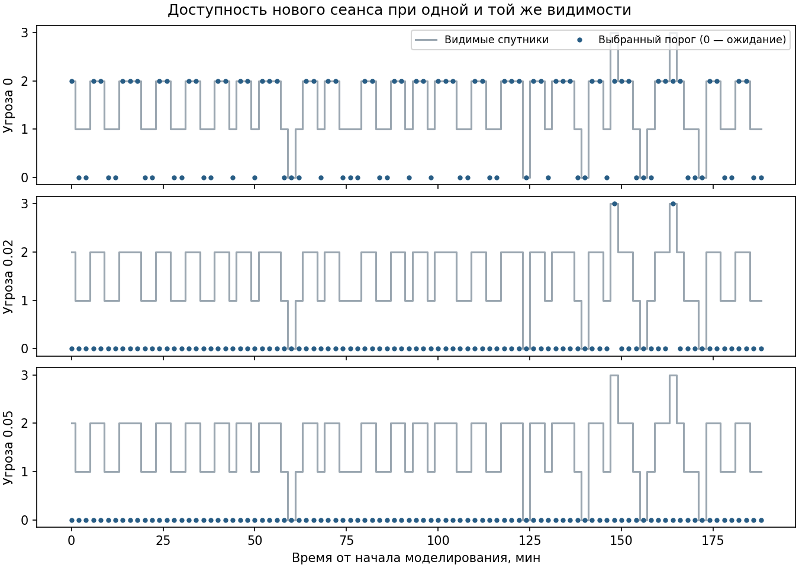

# Разделение сессионного ключа между спутниками

**Вопрос для защиты.** Наземная станция видит четыре спутника из шести. Сможет ли она собрать ключ, если один из четырёх потеряет связь? При пороге 3 из 6 оставшихся трёх хватит. Для XOR и CRT из этой работы нужны все шесть. Зато при захвате трёх спутников полный ключ раскроется лишь в первом случае. Для решения важны два числа — сколько узлов могут выбыть и сколько долей может получить нарушитель.

## Показать за три минуты

Из корня репозитория с установленным uv:

```console
uv run --locked python -m satellite_key_management.analysis.demo
uv run --locked --extra analysis python -m satellite_key_management.analysis --out results
uv run --locked python -m pytest -q
```

1. Запустите демонстрацию. Три плоскости из пособия дают секрет 6. Уберите одну — останется прямая из 11 точек. Затем покажите ключ 42 при шести участниках XOR и CRT и результат при пяти.
2. Откройте столбчатую диаграмму. Назовите порог каждой схемы **до** сравнения времени. Строки опыта с `scenario_k=6` позволяют сравнить четыре реализации при одинаковом требовании «все шестеро».
3. Объясните, как угроза ограничивает доступность. В последнем примере демо видны четыре узла из шести. Политика выбирает пороги 2 и 3, затем откладывает сессию при росте оценки угрозы.

## Что считается защищённым

Дилер доверенный. У каждого спутника одна подлинная доля одной раздачи. Нарушитель пассивно читает доли разных узлов. Индексы, длина ключа, параметры поля и правила выдачи публичны. Подмена, подтверждение отправителя и доставка долей по защищённому каналу требуют отдельных механизмов. Даже правильное число долей само по себе не подтверждает их происхождение.

При пороге t из n любая коалиция из t узлов восстанавливает ключ. Полная компрометация по прочитанным долям наступает при m ≥ t. До порога Шамир, описанная ниже конструкция Блэкли и XOR сохраняют априорное распределение ключа при равномерных независимых масках. Для CRT действует отдельная статистическая оценка. Вероятность угадать случайный b-битный ключ за одну попытку до получения каких-либо долей равна 2⁻ᵇ.

## От формул к реализации

**Блэкли.** По §12.1.1 секрет S записывается в первую координату точки (S, u₂, …, uₖ). Остальные координаты независимы и равномерны в GF(p). Доля — коэффициенты уравнения a₁x₁ + … + aₖxₖ + c = 0 mod p. При выдаче вычисляем c = −a·u. При сборке применяем исключение Гаусса с обращением ненулевого элемента по модулю p. Деление в вещественных числах здесь дало бы другую задачу.

Чтобы **любые** k уравнений имели единственную общую точку, нормали в программе взяты из матрицы Коши. Для строк взяты различные x = k, …, k+n−1, для столбцов y = 0, …, k−1, элемент равен (x−y)⁻¹ mod p. При n+k ≤ p множества меток не пересекаются. Любой квадратный минор ненулевой по формуле определителя Коши. У m < k строк подматрица последних k−1 столбцов имеет ранг m. При любом предположении о первой координате подходят ровно p^(k−1−m) наборов масок. Это доказывает конфиденциальность самой координаты и объясняет выбор нормалей.

Проверка вручную по примеру на **печатной с. 261**. Для нормалей с константами (4,8,2,6), (2,6,8,3), (6,8,4,1) подставьте (6,4,2). Получатся 66, 55 и 77 — все делятся на 11. Единственная точка даёт S = 6. Первым двум уравнениям удовлетворяет также точка (7,6,3). При подстановке получаются 88 и 77. Значит, обладатели двух долей допускают и S = 7.

**Шамир.** Используется реализация участника 1 над тем же GF(p). S — свободный член случайного полинома степени не выше k−1. Доля хранит номер и значение полинома. Интерполяция Лагранжа по k различным номерам даёт f(0). Так обе пороговые схемы решают одну задачу разными представлениями доли.

**XOR, (N,N).** Дилер берёт N−1 равномерных независимых b-битных масок. Последняя доля равна XOR ключа и всех масок. При сложении всех долей каждая маска встречается дважды и сокращается. Даже при наличии N−1 долей любому ключу соответствует одно значение недостающей доли. Ширина b задаётся перед раздачей и одинакова для нулевого ключа и ключа со старшим единичным битом. В демонстрации используется `XorScheme(n, bits)`, который проверяет номера участников.

**CRT, (N,N).** Раздать остатки короткого ключа напрямую опасно: модуль больше ключа раскрыл бы его целиком. В проекте Q = 2ᵇ, M — произведение публичных попарно взаимно простых нечётных модулей, L = ⌊M/Q⌋. Дилер равномерно выбирает A от 0 до L−1 и раздаёт остатки числа Y = S + QA. Полный набор остатков по китайской теореме однозначно задаёт Y в [0,M). Получаем ключ как Y mod Q.

Для неполной коалиции с произведением модулей D наблюдение эквивалентно Y mod D. Поскольку НОД(Q,D)=1, за каждый блок из D последовательных значений A встречаются все остатки. Их количества для любого S равны ⌊L/D⌋ или ⌈L/D⌉. Все секреты совместимы с наблюдением, однако вероятности могут чуть различаться. Расстояние полной вариации между наблюдениями для двух секретов не превышает D/(2L). Каждый пропущенный модуль больше Q·2⁶⁴ при стандартных параметрах. Поэтому L ≥ D·2⁶⁴ и оценка меньше 2⁻⁶⁴. Это статистическая гарантия при одной раздаче.

## Сравнительный эксперимент

[Таблица измерений](results/benchmark.csv) · [Коалиции от 0 до n долей](results/compromise.csv) · [Доступность во времени](results/visibility.csv)

Ключи 64, 128 и 256 бит. Пары (n,k) равны (4,2), (6,3), (6,6) и (10,4). Для общей ширины и одной пары параметров все реализации используют один и тот же случайный ключ. Каждая строка — медиана семи серий по 30 операций. До измерения проверяется восстановление. Время включает генерацию новых масок, расчёт долей и локальные проверки внутри операции. Построение параметров CRT, выбор набора долей, передача по сети и сохранение файлов находятся за пределами таймера. Восстановление измеряется на минимальном достаточном наборе.

Прогон от 19 ноября 2026 года для 128 бит и n=6. Поля `split_mad_us` и `recover_mad_us` в CSV показывают медианное абсолютное отклонение семи серий, в микросекундах на операцию. Небольшое различие медиан относительно разброса не даёт основания ранжировать две реализации.

| Схема | Требуется долей | Размер доли, байт | Выдача шести долей, мкс | Сборка ключа, мкс | Допустимо потерь |
|---|---:|---:|---:|---:|---:|
| Шамир | 3 | 33 | 5,12 | 6,54 | 3 |
| Блэкли | 3 | 128 | 23,94 | 17,61 | 3 |
| XOR | 6 | 17 | 2,96 | 2,45 | 0 |
| CRT | 6 | 26 | 5,14 | 5,19 | 0 |

Размер в байтах рассчитан для фиксированного двоичного представления полезной нагрузки. Шамир передаёт метку и одно значение поля, Блэкли — все k+1 коэффициентов уравнения. Для XOR и CRT передаются номер узла и маска либо остаток. Открытые параметры доступны участникам заранее. Длина номера определяется n, длина каждого числа — публичным диапазоном. Заголовки сети, аутентификация и объекты Python в размер не входят. При 128 битах для обеих пороговых схем выбрано поле p = 2²⁵⁵−19, один элемент занимает 32 байта. В варианте Блэкли с заранее известными нормалями передача только номера строки и константы сократила бы долю до 33 байт. В представленной таблице измеряется формат полного уравнения из пособия. Выводы о размере и скорости относятся к этим форматам и реализациям.





На лепестковой диаграмме первые три шкалы равны «минимальное значение в группе / значение реализации». В двух остальных показаны (t−1)/n и (n−t)/n. Большее значение по каждой оси предпочтительно для соответствующего свойства. Столбец `full_recovery` в таблице коалиций — теоретический признак однозначного восстановления по m подлинным долям. Времена, напротив, измерены на компьютере и меняются при повторном запуске.

## Динамический порог и цена доступности

В модели уровень угрозы r ∈ [0,1] переводится в бюджет нарушителя m = ⌈r(n−1)⌉. Это параметр сценария. При v видимых спутниках выбирается k = max(2, ⌈v/2⌉, m+1). Для созвездия из одного спутника нижняя граница равна 1. При k > v сеанс откладывается. `dynamic_k()` вычисляет рекомендацию. `distribute_adaptive()` открывает новую сессию с независимым ключом и новыми долями. Порог уже выданных долей сохраняется. Симуляция моделирует предварительную раздачу всем n узлам, а видимость ограничивает последующий сбор.

Если новую сессию приходится отложить, вызов возвращает `None`, а доли и ключ предыдущей сессии продолжают относиться к прежнему порогу.

В сохранённом опыте модель команды использует 72 спутника, 6 плоскостей и seed=7. Станция на 55° с. ш., 37° в. д., угол места от 10°. Видимость проверена в 95 дискретных моментах от 0 до 188 мин с шагом 2 мин.

| Уровень r | Бюджет m | Минимум для защиты | Моменты, в которые сессия возможна |
|---:|---:|---:|---:|
| 0 | 0 | 2 | 53 / 95 (55,8 %) |
| 0,02 | 2 | 3 | 2 / 95 (2,1 %) |
| 0,05 | 4 | 5 | 0 / 95 (0 %) |

В рассмотренной геометрии для защиты от двух скомпрометированных спутников нужны как минимум три видимых. Они одновременно доступны только в двух отсчётах. Это количественный результат для заданной орбитальной модели и станции. На защите его можно воспроизвести и обсудить, как изменение станции или числа спутников повлияет на доступность.



## Что показать преподавателю на одном пролёте

В конце команды `analysis.demo` выполняется сценарий `simulation/telemetry.py`. На 53-й минуте станция видит спутники 8, 69 и 70. Эти три спутника выбраны участниками демонстрационной группы. Дилер генерирует независимый 16-байтный ключ для каждой схемы, раздаёт доли и шифрует одно сообщение AES-GCM. Станция восстанавливает ключ из доступных долей и проверяет тег. Номера спутников могут быть любыми, при этом внутренние индексы долей каждой схемы остаются от 1 до n.

На 54-й минуте видны только 8 и 69. Шамир и Блэкли при пороге 2 продолжают доставлять `temperature=21.5`. У XOR и CRT порог 3, и программа возвращает ожидание. Ещё один тест меняет связанные данные пакета и проверяет отказ AES-GCM. Демонстрация состоит из двух наблюдений одного пакета. Защита от повторной доставки и аутентификация канала раздачи долей требуют отдельных протоколов.

Для сравнения производительности при одинаковом требовании используйте строки `bits=128, n=6, scenario_k=6`. В этом прогоне сборка всех шести долей заняла около 16,94 мкс у Шамира, 96,98 мкс у Блэкли, 2,55 мкс у XOR и 5,61 мкс у CRT. Для Блэкли с ростом k увеличиваются и число коэффициентов в доле, и размер системы, которую решает метод Гаусса. При k=3 доля в формате полного уравнения занимает 128 байт, при k=6 — 224.

## Привязка к курсу

- Владимиров, Габидулин, Колыбельников, Кшевецкий. «Криптографические методы защиты информации», черновой вариант третьего издания от 06.11.2021. Глава 12, §12.1.1–12.1.3, печатные с. 259–265; приложение А, §А.5.6, с. 355. Из пособия взяты определения и числовой пример. Выбор матрицы Коши, рандомизация CRT и политика видимости описывают решения в проекте.
- Программа «Защита информации» («Правила игры ЗИ»). Лекция 1 и семинар 2 — секретность по Шеннону. Лекция 3 и семинар 3 — поля и КТО. Лекция 8 и семинар 9 — пороговые схемы. Критерии курсового проекта на с. 18 отдельно учитывают полноту, корректность и научный результат. В работе воспроизводятся пример из пособия и пороговые свойства, а также приведён собственный измерительный эксперимент. Оценку новизны и баллы определяет преподаватель.
